# 冰箱管家交互流程图

> 风格关键词：米白背景、柔和绿色、圆角保鲜盒卡片、临期暖橙、过期柔红。  
> 可直接复制下方 Mermaid 到支持 Mermaid 的工具中导出 SVG/PNG，再放入 PPT。  
> 已导出优化版 SVG：`IXD_FLOWCHART.svg`。

```mermaid
%%{init: {
  "theme": "base",
  "themeVariables": {
    "background": "#F8F4E9",
    "primaryColor": "#FFFDF7",
    "primaryTextColor": "#2D343A",
    "primaryBorderColor": "#95D2B3",
    "lineColor": "#95D2B3",
    "secondaryColor": "#EEF8F2",
    "tertiaryColor": "#FBF7EC",
    "fontFamily": "PingFang SC, Microsoft YaHei, sans-serif"
  }
}}%%

flowchart LR
  subgraph S1[01 入库流程]
    A([用户进入<br/>冰箱管家]):::start --> B[首页<br/>库存概览]:::home
    B --> C[添加页<br/>拍照 / 相册]:::capture
    C --> D[AI 识别<br/>名称 / 类别 / 置信度]:::ai
    D --> E{识别成功？}:::decision
    E -- 成功 --> F{入库方式}:::decision
    F -- 整份 --> G[整份熟食<br/>整体入库]:::card
    F -- 拆分 --> H[拆分食材<br/>生成清单]:::card
    G --> I[确认保存方式<br/>冷藏 / 冷冻 / 常温]:::storage
    H --> I
    E -. 失败 .-> J[异常兜底<br/>重新识别 / 手动输入]:::warning
    J -.-> I
    I --> K[自动计算<br/>保质期与到期日]:::card
    K --> L[保存入库]:::success
  end

  subgraph S2[02 管理闭环]
    L --> M[回到首页<br/>刷新库存]:::home
    M --> N{食物状态<br/>风险判断}:::decision
    N -- 新鲜 --> O[新鲜<br/>绿色状态]:::fresh
    N -- 临期 --> P[临期<br/>暖橙倒计时]:::near
    N -- 过期 --> Q[过期<br/>柔红警示]:::expired
    O --> R[详情页<br/>查看食物信息]:::detail
    P --> R
    Q --> R
    R --> T{用户处理}:::decision
    T -- 调整 --> U[调整保存方式<br/>重新计算]:::storage
    T -- 吃完 --> V[吃完<br/>确认 + 可撤销]:::success
    T -- 删除 --> W[丢弃 / 删除<br/>确认防误操作]:::danger
    U --> X[返回首页<br/>继续管理]:::home
    V --> Y[统计页<br/>总记录 / 已吃完 / 已过期]:::stats
    W --> Y
    Y --> X
    M -. 网络 / 图片异常 .-> Z[兜底反馈<br/>明确原因 + 重试]:::warning
    Z -. 恢复后 .-> M
  end

  classDef start fill:#95D2B3,stroke:#5FAE86,color:#FFFFFF,stroke-width:2px;
  classDef home fill:#FFFDF7,stroke:#95D2B3,color:#2D343A,stroke-width:2px;
  classDef capture fill:#EEF8F2,stroke:#95D2B3,color:#2D343A,stroke-width:2px;
  classDef ai fill:#EAF6EF,stroke:#5FAE86,color:#2D343A,stroke-width:2px;
  classDef decision fill:#FBF7EC,stroke:#B8C7B8,color:#2D343A,stroke-width:2px;
  classDef card fill:#FFFDF7,stroke:#D8D0BD,color:#2D343A,stroke-width:1.5px;
  classDef storage fill:#F6F1E4,stroke:#95D2B3,color:#2D343A,stroke-width:2px;
  classDef success fill:#DFF2E7,stroke:#5FAE86,color:#2D343A,stroke-width:2px;
  classDef fresh fill:#E8F5E9,stroke:#6E9B3E,color:#2D343A,stroke-width:2px;
  classDef near fill:#FFF3E0,stroke:#F5B86E,color:#2D343A,stroke-width:2px;
  classDef expired fill:#FFEBEE,stroke:#D86464,color:#2D343A,stroke-width:2px;
  classDef detail fill:#FFFDF7,stroke:#95D2B3,color:#2D343A,stroke-width:2px;
  classDef stats fill:#EEF8F2,stroke:#5FAE86,color:#2D343A,stroke-width:2px;
  classDef warning fill:#FFF3E0,stroke:#F5B86E,color:#2D343A,stroke-width:2px;
  classDef danger fill:#FFEBEE,stroke:#D86464,color:#2D343A,stroke-width:2px;

  linkStyle 9,10,16,19,29,30 stroke:#F5B86E,stroke-width:3px;
  linkStyle 17,20,24,27 stroke:#D86464,stroke-width:3px;
```

## PPT 使用建议

- 如果一页放不下，拆成两页：
  1. **入库流程**：添加 → AI 识别 → 整份/拆分 → 保存方式 → 入库。
  2. **管理闭环**：首页状态 → 详情处理 → 吃完/丢弃 → 统计 → 返回首页。
- 主标题建议：**从拍照入库到临期处理的交互闭环**。
